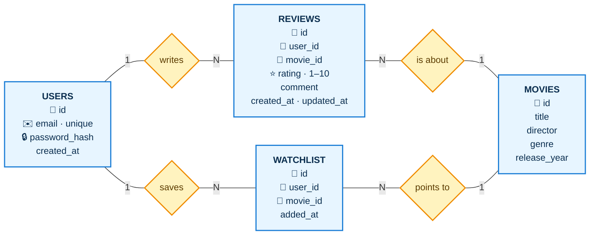

# FE25 FilmRecension

FilmRecension is a backend for a movie site. Visitors can browse movies and read reviews. Logged-in users can write, edit and delete their own reviews and keep a private watchlist of movies they want to see.

There is no frontend. The API is used with a tool like Thunder Client, Postman or `curl`, and every answer is JSON.

**Built with:** Node.js · Express 4 · MySQL 8 · mysql2 · bcrypt · jsonwebtoken · dotenv

---

## Contents

1. [Getting started](#getting-started)
2. [How a request moves through the code](#how-a-request-moves-through-the-code)
3. [Endpoints](#endpoints)
4. [Database and ER diagram](#database-and-er-diagram)
5. [Security](#security)
6. [Rules and decisions](#rules-and-decisions)

---

## Getting started

You need **Node.js 18+** and **MySQL 8**.

**1. Install the packages**

```
git clone https://github.com/eliassjoholm/fe25-filmrecension.git
cd fe25-filmrecension
npm install
```

**2. Create your `.env` file**

Copy the template and fill in your own MySQL password and a long random JWT secret:

```
copy .env.example .env
```

A random secret can be generated with:

```
node -e "console.log(require('crypto').randomBytes(32).toString('hex'))"
```

**3. Create the database**

`database/setup.sql` builds the `filmrecension_db` database with all four tables and six sample movies. It removes an old `filmrecension_db` first, so running it again gives a clean start.

```
mysql -u root -p < database/setup.sql                   # Git Bash / cmd
Get-Content database/setup.sql | mysql -u root -p      # PowerShell
```

On Windows, if `mysql` isn't found, use the full path, e.g. `"C:\Program Files\MySQL\MySQL Server 8.4\bin\mysql.exe"`.

**4. Start the server**

```
npm start
```

Or `npm run dev` to restart automatically when a file changes. The API runs on `http://localhost:3000` (or the `PORT` in `.env`).

**5. Add users and reviews**

Users are not in the SQL file on purpose: create them with `POST /api/auth/register` so their passwords are hashed by the API. Then log in, copy the token and post a few reviews.

---

## How a request moves through the code

```
Client ──► server.js ──► routes/ ──► middleware/ ──► controllers/ ──► models/ ──► MySQL
                                   (login + input)   (HTTP logic)    (SQL)
Client ◄──────────────────── JSON response ◄──────────────────────────────┘
```

| Folder / file | Job |
|---|---|
| `server.js` | Creates the Express app, connects the routers and starts the server |
| `db.js` | MySQL connection pool and a small `query()` helper (prepared statements) |
| `routes/` | Says which URL goes to which controller, and which checks run first |
| `middleware/authenticate.js` | Checks the JWT and saves the user's id on `req.userId` |
| `middleware/validators.js` | Checks ids, email, password, rating and comment before the controller runs |
| `middleware/errorHandler.js` | Turns every error into a JSON answer with the right status code |
| `controllers/` | Handles one request: calls the models and picks the status code |
| `models/` | Classes `Movie`, `Review`, `User` and `Watchlist`, which hold all the SQL |
| `utils/HttpError.js` | Error class that carries a status code, e.g. `new HttpError(404, 'Movie not found')` |
| `utils/asyncHandler.js` | Sends errors from async controllers to the error handler |
| `database/setup.sql` | Creates the database, tables and sample movies |

**Example:** `PUT /api/reviews/4`
1. `routes/reviewRoutes.js` runs `authenticate` → the token is valid, so `req.userId = 2`.
2. `checkId` makes sure `4` is a positive whole number; `checkReview` checks the rating and comment.
3. `reviewController.updateReview` loads review 4 with `Review.findById(4)`.
4. `review.belongsTo(2)` is false → `HttpError(403)` → the error handler answers `403 { "error": "This review belongs to another user" }`.

---

## Endpoints

🔓 = public · 🔑 = needs `Authorization: Bearer <token>` · 👤 = only the owner of the review

### Accounts

| | Method | URL | What it does |
|---|---|---|---|
| 🔓 | POST | `/api/auth/register` | Create an account |
| 🔓 | POST | `/api/auth/login` | Log in, get a token |
| 🔑 | GET | `/api/auth/me` | Show the logged-in user |

```json
{ "email": "anna@test.com", "password": "password123" }
```

The email must be valid and the password 8–72 characters. Login answers with `{ "token": "...", "user": { ... } }`.

### Movies

| | Method | URL | What it does |
|---|---|---|---|
| 🔓 | GET | `/api/movies` | All movies with average rating and number of reviews |
| 🔓 | GET | `/api/movies?search=matrix` | Movies whose title contains the text |
| 🔓 | GET | `/api/movies?genre=crime` | Movies in one genre (can be combined with `search`) |
| 🔓 | GET | `/api/movies/:id` | One movie |

```json
{ "id": 1, "title": "Interstellar", "director": "Christopher Nolan", "genre": "Sci-Fi",
  "year": 2014, "averageRating": 8.5, "reviewCount": 2 }
```

### Reviews

| | Method | URL | What it does |
|---|---|---|---|
| 🔓 | GET | `/api/movies/:movieId/reviews` | All reviews of a movie |
| 🔑 | POST | `/api/movies/:movieId/reviews` | Write a review |
| 👤 | PUT | `/api/reviews/:id` | Change your own review |
| 👤 | DELETE | `/api/reviews/:id` | Delete your own review |

```json
{ "rating": 8, "comment": "Great ending!" }
```

The rating must be a whole number from 1 to 10. The comment can't be empty and can be at most 1000 characters. PUT always sends both fields.

### Watchlist

| | Method | URL | What it does |
|---|---|---|---|
| 🔑 | GET | `/api/watchlist` | My saved movies, newest first |
| 🔑 | POST | `/api/watchlist/:movieId` | Save a movie |
| 🔑 | DELETE | `/api/watchlist/:movieId` | Remove a saved movie |

### Errors

Every error has the same shape: `{ "error": "message" }`.

| Status | When |
|---|---|
| 200 / 201 | OK / something was created |
| 400 | Bad input: id, email, password, rating, comment, search text or broken JSON |
| 401 | No token, a broken token, an expired token, or a wrong email/password at login |
| 403 | Logged in, but the review belongs to someone else |
| 404 | The movie, review, watchlist entry, user or route doesn't exist |
| 409 | Email already registered, movie already reviewed, or movie already on the watchlist |
| 500 | Unexpected server error (logged in the terminal, never sent to the client) |

---

## Database and ER diagram

Entities are boxes, relationships are diamonds, and the numbers on the lines show the cardinality (1 to N).



| Symbol | Meaning |
|---|---|
| 🔑 | Primary key |
| 🔗 | Foreign key (points to `users.id` or `movies.id`) |
| `1 ── N` | One row on the left can have many rows on the right |
| unique pair | `reviews (user_id, movie_id)` and `watchlist (user_id, movie_id)` |

- **users → reviews / watchlist:** one user can have many reviews and many saved movies.
- **movies → reviews / watchlist:** one movie can have many reviews and be saved by many users.
- **UNIQUE:** `users.email`, `reviews (user_id, movie_id)` and `watchlist (user_id, movie_id)`.
- **Foreign keys** make sure a review or saved movie always points to a real user and a real movie. `ON DELETE CASCADE` removes them if the user or movie is deleted.
- The database also checks `rating BETWEEN 1 AND 10`, as a second layer after the API's own validation.

---

## Security

- **Passwords** are hashed with bcrypt (12 rounds) before they are saved. The hash is never returned by the API.
- **JWT:** login returns a token signed with `JWT_SECRET`. It contains only the user's id (`sub`) and runs out after `JWT_EXPIRES_IN` (2 hours by default).
- **Who is the user?** The user id always comes from the verified token (`req.userId`), never from the body or the URL. Sending `"userId": 1` in a request does nothing.
- **Ownership:** before a review is changed or deleted, `review.belongsTo(req.userId)` is checked. Another user gets `403`.
- **Watchlist:** a `Watchlist` object is created for the logged-in user, and every query filters on that user's id.
- **SQL injection:** every query uses `?` placeholders with prepared statements (`pool.execute`). User input is never put into the SQL text.
- **Validation:** ids, email, password, rating, comment and search text are checked in `middleware/validators.js` before anything reaches the database.
- **Login errors** are the same for an unknown email and a wrong password, so nobody can find out which emails are registered.
- **Secrets** (`DB_PASSWORD`, `JWT_SECRET`) live in `.env`, which is in `.gitignore`. `.env.example` only has placeholders.
- **No leaks:** database errors are logged in the terminal; the client only gets `Internal server error`.

---

## Rules and decisions

- **One review per movie per user.** A second review of the same movie gets `409`. To change your opinion, edit the review with PUT or delete it and write a new one.
- **No duplicates on the watchlist.** Saving a movie that is already there gets `409`.
- **PUT, not PATCH,** for editing a review, because the client always sends the whole review (rating and comment).
- **Controllers and models are separate.** Controllers deal with HTTP (status codes, JSON); models deal with SQL. That keeps each file short and easy to follow.
- **Errors are thrown, not answered in every route.** Controllers `throw new HttpError(...)` and one error handler sends the answer, so every error looks the same.
- **Possible next steps:** an admin role to add movies, pagination for long lists, rate limiting on login, and display names so reviews can show who wrote them.
